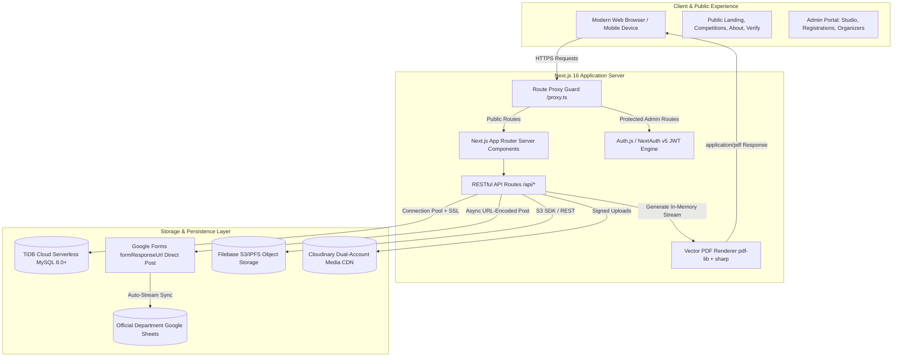

# YUGANTAR 2026 — Architecture & Data Flow Reference

This document provides an in-depth reference for the application architecture, data pipelines, and service integrations powering the **YUGANTAR 2026** platform.

---

## 1. High-Level Architecture Overview

YUGANTAR 2026 is built on a modern, decoupled serverless architecture using **Next.js 16 (Turbopack + App Router)** with **React 19** and **TypeScript 5**. The application serves three distinct user classes:
1. **Public Visitors & Participants:** Discover festival tracks, explore interactive campus maps, register individually or in teams, and download verified passes/certificates.
2. **Event Organizers & Coordinators:** Oversee registrations, track payment statuses, manage organizing committee profiles, and launch official Google Sheets.
3. **Festival Administrators:** Design certificate and pass templates in the Canvas Studio, batch issue credentials, configure festival-wide gating rules, and audit system activity.



---

## 2. Registration Pipeline & Dual-Write Mechanics

### The Dual-Write Challenge
In college festival operations, student teams and faculty coordinators rely heavily on Google Sheets for real-time check-in desks, while the web platform requires low-latency relational persistence for automated passes, certificate generation, and duplicate prevention.

YUGANTAR 2026 solves this through an **ordered dual-write workflow**:

```mermaid
sequenceDiagram
    autonumber
    actor Participant as Participant / Team Leader
    participant WebClient as Registration Form (React 19)
    participant ApiRoute as POST /api/register
    participant TiDB as TiDB Cloud Database
    participant GoogleForm as Google Forms Endpoint
    participant Sheets as Department Google Sheet

    Participant->>WebClient: Fills Dossier & Submits
    WebClient->>ApiRoute: Submits form values + idempotencyKey

    Note over ApiRoute,TiDB: Phase 1: Authoritative Gating & Deduplication
    ApiRoute->>TiDB: Check Global Open & Track Deadline
    ApiRoute->>TiDB: Check Idempotency Key & Duplicate Registration
    
    Note over ApiRoute,TiDB: Phase 2: Primary Relational Persistence
    ApiRoute->>TiDB: INSERT INTO registrations (status: 'pending')
    alt Database Write Fails
        ApiRoute-->>WebClient: Return 500 Error (Registration aborted safely)
    end

    Note over ApiRoute,GoogleForm: Phase 3: External Form Forwarding
    alt send_to_spreadsheet setting is ENABLED
        ApiRoute->>GoogleForm: POST formResponseUrl (url-encoded entry.XXXX)
        alt Google Form Returns Confirmation
            GoogleForm-->>Sheets: Google automatically streams row to sheet
            ApiRoute->>TiDB: UPDATE registrations (status: 'confirmed' or 'submitted')
        else Google Form Times Out / Rejects
            ApiRoute->>TiDB: UPDATE registrations (status: 'failed', error recorded)
            Note over ApiRoute,TiDB: Data remains safe in TiDB for admin reconciliation
        end
    else Setting is DISABLED
        ApiRoute->>TiDB: UPDATE registrations (status: 'confirmed' or 'submitted')
    end

    ApiRoute-->>WebClient: Return 200 { registrationId, passUrl, status }
    WebClient-->>Participant: Render Confetti & Instant Pass Download Link
```

### Critical Non-Atomic Failure Behavior
- **Primary Single Source of Truth:** TiDB is the authoritative system of record. If the TiDB write fails, no Google Form submission is attempted, preventing phantom entries in sheets.
- **Graceful Network Degradation:** If Google Forms times out or is temporarily rate-limited, the registration is **not lost**. It remains securely persisted in TiDB with `submission_status = 'failed'` or `'unknown'` along with `submission_error`. Administrators can view and reconcile these entries from the Admin Registrations portal.

---

## 3. Pass & Certificate Generation Pipeline

PDF passes and certificates are generated **entirely in memory on demand** using `pdf-lib`, `sharp`, and `qrcode`. No temporary binary PDFs are written to disk, and no binary blobs are stored in the database.

```mermaid
graph LR
    subgraph RequestTrigger
        UserReq[GET /api/pass/:id/pdf or Batch Issue]
    end

    subgraph TemplateResolution
        FetchReg[Fetch Registration & form_data]
        FetchTpl[Resolve Active Template Global vs Track]
        TokenMap[Map Dynamic Tokens: Name, Team, ID, Track]
    end

    subgraph VectorAssembly
        DocInit[Create PDFDocument width_pt x height_pt]
        DrawBg[Embed Background Image / Pattern]
        DrawVectors[Draw Rectangles, Lines, Text, Citations]
        DrawQR[Generate 2D QR Matrix with HMAC Validation]
    end

    subgraph Delivery
        StreamBytes[doc.save -> Uint8Array Buffer]
        HttpResp[Stream application/pdf to Browser]
    end

    UserReq --> FetchReg
    FetchReg --> FetchTpl
    FetchTpl --> TokenMap
    TokenMap --> DocInit
    DocInit --> DrawBg
    DrawBg --> DrawVectors
    DrawVectors --> DrawQR
    DrawQR --> StreamBytes
    StreamBytes --> HttpResp
```



### Multi-Member Issuance Policy
When generating certificates or passes for team tracks (e.g., *Project Competition*, *Hardware Hackathon*):
- **Individual Policy (Default):** The engine reads `form_data` JSON from `registrations`, iterates over all listed team members plus the team leader, and generates a personalized document with their exact full name.
- **Leader / Solo Policy:** Generates a document for the primary registrant/team leader only.

---

## 4. Administrative Security & Route Protection

Next.js 16 introduces `proxy.ts` (replacing legacy `middleware.ts`). Administrative security is enforced at two layers:

1. **Edge Proxy Layer (`src/proxy.ts`):**
   - Intercepts all requests matching `/admin/*` (excluding `/admin/login`).
   - Verifies the presence of Auth.js / NextAuth session cookies (`authjs.session-token`, `__Secure-authjs.session-token`).
   - Unauthenticated requests are immediately redirected to `/admin/login?callbackUrl=...`.

2. **Server Route Handler Layer (`src/lib/auth.ts` & API routes):**
   - Every administrative API route calls `requireAdmin(allowedRoles)`.
   - Validates the decoded JWT session against the database user record to ensure the administrator is actively enabled (`is_enabled = 1`).
   - Logs significant administrative actions to the `audit_log` table with administrator ID, email, action type, entity ID, and timestamp.
