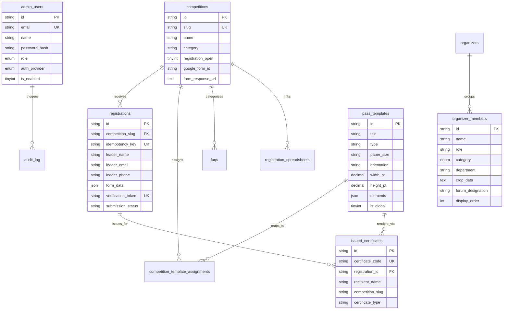

# YUGANTAR 2026 — Database Schema Reference

This document provides a comprehensive reference for the relational database schema supporting **YUGANTAR 2026**, deployed on **TiDB Cloud Serverless (MySQL 8.0+ compatible)**.

---

## 1. Database Connection & Client Architecture

- **Driver:** `mysql2/promise` (Native connection pool singleton in `src/lib/db.ts`).
- **Connection Configuration:**
  - Standard MySQL URL parsed via Node.js `URL`.
  - SSL Configuration: Required for TiDB Cloud Serverless (`ssl: { rejectUnauthorized: true }`).
  - Connection Pool Limits: `connectionLimit: 10`, `queueLimit: 0`, `waitForConnections: true`.
  - Development Connection Caching: Stored on `globalThis` to prevent connection exhaustion during Next.js Turbopack Hot Module Replacement (HMR).

---

## 2. Entity Relationship Diagram (ERD)



---

## 3. Relational Table Specifications

### 3.1 `registrations`
Primary ledger for all participant and team registrations.

| Column | Type | Constraints | Description |
|---|---|---|---|
| `id` | VARCHAR(36) | PRIMARY KEY | Unique UUID identifier for the registration dossier |
| `competition_slug` | VARCHAR(100) | NOT NULL, INDEX | Foreign key slug matching the competition track |
| `idempotency_key` | VARCHAR(200) | UNIQUE, NULL | Deduplication hash (`${email}_${slug}_${timestamp}`) |
| `leader_name` | VARCHAR(255) | NOT NULL | Full name of team leader or solo participant |
| `leader_email` | VARCHAR(255) | NOT NULL, INDEX | Primary contact and verification email |
| `leader_phone` | VARCHAR(50) | NOT NULL | Contact phone number |
| `leader_college` | VARCHAR(255) | NOT NULL | Name of institution / university |
| `leader_branch` | VARCHAR(100) | NOT NULL | Academic branch (e.g., ETC, CSE, Mechanical) |
| `leader_semester` | VARCHAR(20) | NOT NULL | Current semester of study |
| `team_name` | VARCHAR(255) | NULL | Name of squad/team (for team events) |
| `team_size` | INT | DEFAULT 1 | Total team member count (1 to 5) |
| `form_data` | JSON | NULL | Full submitted dossier, including dynamic team members |
| `payment_id` | VARCHAR(255) | NULL | 12-digit transaction UTR or receipt reference |
| `payment_proof_url` | TEXT | NULL | CDN URL of uploaded payment screenshot |
| `google_form_id` | VARCHAR(255) | NULL | Corresponding Google Form identifier |
| `submission_status` | VARCHAR(50) | DEFAULT 'pending' | Status: `pending`, `confirmed`, `submitted`, `failed` |
| `submission_error` | TEXT | NULL | Detailed error message if external forwarding failed |
| `verification_token`| VARCHAR(64) | UNIQUE, NULL | Secure hex token embedded in delegate pass QR |
| `submitted_at` | DATETIME | NULL | Timestamp when successfully synced to Google |
| `created_at` | DATETIME | DEFAULT CURRENT_TIMESTAMP | Submission creation timestamp |
| `updated_at` | DATETIME | ON UPDATE CURRENT_TIMESTAMP | Last modification timestamp |

---

### 3.2 `pass_templates`
Canvas document definitions for passes and certificates.

| Column | Type | Constraints | Description |
|---|---|---|---|
| `id` | VARCHAR(36) | PRIMARY KEY | Unique UUID or slug for the template |
| `title` | VARCHAR(255) | NOT NULL | Human-readable template title |
| `description` | TEXT | NULL | Template description and purpose |
| `type` | VARCHAR(50) | NOT NULL, INDEX | Type: `registration_pass`, `participation_cert`, `merit_cert`, `coordinator_pass`, `id_badge` |
| `paper_size` | VARCHAR(50) | DEFAULT 'A4' | Format: `A4`, `A5`, `ID_BADGE`, `CERTIFICATE`, `CUSTOM` |
| `orientation` | VARCHAR(20) | DEFAULT 'portrait' | Orientation: `portrait` or `landscape` |
| `width_pt` | DECIMAL(8,2) | DEFAULT 595.28 | Canvas width in typography points ($72\text{ pt} = 1\text{ in}$) |
| `height_pt` | DECIMAL(8,2) | DEFAULT 841.89 | Canvas height in typography points |
| `background_url` | TEXT | NULL | Persistent URL for canvas background asset |
| `background_fit` | VARCHAR(20) | DEFAULT 'cover' | Fit mode: `cover`, `contain`, `stretch` |
| `background_opacity`| DECIMAL(3,2) | DEFAULT 1.00 | Background layer alpha ($0.00$ to $1.00$) |
| `elements` | JSON | NOT NULL | Serialized array of vector and text element objects |
| `is_published` | TINYINT | DEFAULT 1 | Whether template is available for issuance |
| `is_global` | TINYINT | DEFAULT 0 | Global default fallback for all competitions |
| `version` | INT | DEFAULT 1 | Optimistic concurrency increment version |
| `created_at` | DATETIME | DEFAULT CURRENT_TIMESTAMP | Template creation timestamp |
| `updated_at` | DATETIME | ON UPDATE CURRENT_TIMESTAMP | Last layout update timestamp |

---

### 3.3 `issued_certificates`
Audit ledger of generated and issued certificates.

| Column | Type | Constraints | Description |
|---|---|---|---|
| `id` | VARCHAR(36) | PRIMARY KEY | Unique certificate record UUID |
| `certificate_code` | VARCHAR(50) | UNIQUE, NOT NULL | Verifiable code (e.g. `YUG-2026-PC-9821`) |
| `registration_id` | VARCHAR(36) | NULL, INDEX | Reference back to parent `registrations.id` |
| `recipient_name` | VARCHAR(255) | NOT NULL | Full personalized name on certificate |
| `recipient_email` | VARCHAR(255) | NULL | Email address of the recipient |
| `recipient_college`| VARCHAR(255) | NULL | College name displayed on citation |
| `competition_slug` | VARCHAR(100) | NOT NULL, INDEX | Event competition slug |
| `certificate_type` | VARCHAR(50) | NOT NULL | Type: `participation_cert`, `merit_cert`, `appreciation_cert` |
| `rank_citation` | VARCHAR(100) | DEFAULT 'Certificate of Participation' | Position citation (e.g., 1st Prize, Finalist) |
| `template_id` | VARCHAR(36) | NULL | Pass template used for rendering |
| `issued_by` | VARCHAR(255) | DEFAULT 'admin' | Issuer user ID or automated service |
| `issued_at` | DATETIME | DEFAULT CURRENT_TIMESTAMP | Timestamp of issuance |
| `revoked_at` | DATETIME | NULL | Timestamp if revoked by administrator |
| `revocation_reason`| VARCHAR(255) | NULL | Reason text if certificate is revoked |

---

### 3.4 `organizer_members`
Committee members, faculty mentors, and TurboBits student team profiles.

| Column | Type | Constraints | Description |
|---|---|---|---|
| `id` | VARCHAR(36) | PRIMARY KEY | Member record UUID |
| `name` | VARCHAR(255) | NOT NULL | Full name of the member |
| `role` | VARCHAR(255) | NOT NULL | Functional role (e.g., Full Stack Engineer) |
| `category` | ENUM | NOT NULL | `turbo_bits`, `faculty`, `core_committee` |
| `organization_id` | VARCHAR(36) | NULL, INDEX | Optional parent organization reference |
| `department` | VARCHAR(255) | NULL | Academic department / division |
| `bio` | TEXT | NULL | Brief biography or track responsibility |
| `avatar_url` | TEXT | NULL | Direct URL or Google CDN link to portrait |
| `crop_data` | TEXT | NULL | JSON string holding `{ zoom, x, y, shape }` |
| `forum_designation`| VARCHAR(255) | NULL | Optional TELE-ERA Student Forum office (e.g., Secretary) |
| `display_order` | INT | DEFAULT 0 | Administrative sort rank |
| `is_published` | TINYINT(1) | DEFAULT 1 | Public visibility flag |

---

### 3.5 Supporting System Tables

- **`admin_users`:** Holds administrator credentials (`password_hash` via bcrypt), RBAC roles (`super_admin`, `content_admin`, `registration_admin`, `readonly_admin`), and authentication provider modes.
- **`site_settings`:** Key-value configuration store for global toggles (e.g., `registration_global_open`, `send_to_spreadsheet`, `show_organizer_order`, `festival_start_date`).
- **`competitions`:** Authoritative table for festival competitions, eligibility, team size bounds, venue, UPI IDs, registration deadlines, and Google Form mappings.
- **`registration_spreadsheets`:** Directory of official Google Sheets linked to specific competitions.
- **`audit_log`:** Structured audit trail recording sensitive administrator operations with IP and action metadata.
- **`media_assets`:** Asset catalogue tracking uploaded images, signatures, and backgrounds.

---

## 4. Database Setup & Migration Commands

To safely run migrations in development:

```bash
# 1. Initialize core registrations table
node scripts/init-db.mjs

# 2. Run administrator portal and configuration migration
node scripts/migrate-admin.mjs

# 3. Run Pass & Certificate Studio schema migration
node scripts/migrate-studio.mjs

# 4. Run Issued Certificates ledger migration
node scripts/migrate-certificates.mjs
```

> [!WARNING]
> All migration scripts use `CREATE TABLE IF NOT EXISTS` and `ALTER TABLE ... ADD COLUMN` statements. They are designed to be safe and idempotent. Never execute `DROP TABLE` or destructive DDL on production databases without taking a backup first.
